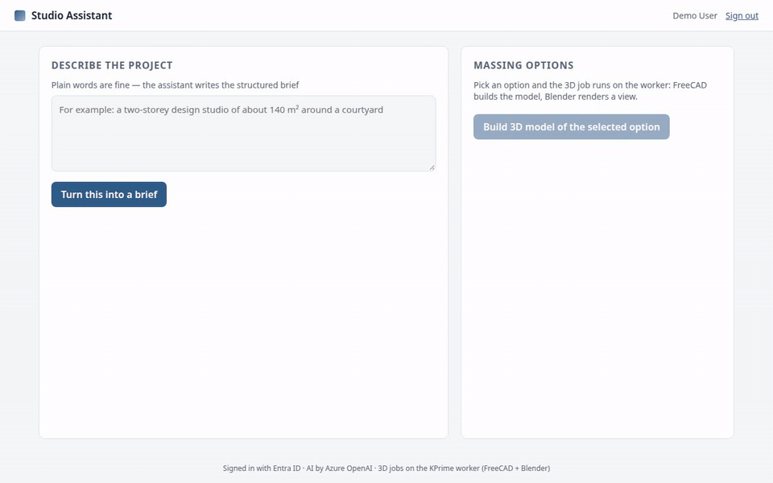

# Studio Assistant

An internal design aid for an architecture firm: an architect describes a project in plain words, gets a structured brief from an AI model,
and picks a massing option that a GPU worker builds as a 3D model and renders as a picture.



## What it does

- A user types a plain-words project description and gets back a structured design brief: the spaces with their areas, site and orientation
  notes, a suggested next step, and two or three genuinely different massing options, each with a small site plan.
- The AI part (Azure OpenAI, gpt-4.1-mini) writes that brief as strict JSON and is told the shape of it: indoor space areas that add up to the
  ask (outdoor spaces listed apart, flagged as such, not in the total), volumes as simple rectangular blocks at about 3.5 m per storey, two or
  three genuinely different options. It answers in JSON only and is told never to invent facts about the firm. Before an answer is shown the
  app checks it deterministically against the brief (areas, enclosure claims, connectivity, storey heights) and asks the model again, at most
  twice, when it fails. (A rule that volumes must share walls was tried and removed: an A/B against the same model showed no measurable effect
  and what had looked like detached blocks was a render-orientation bug, now fixed.)
- The heavy job runs on a GPU worker on KPrime: FreeCAD builds one box per volume as a real FreeCAD document, Blender imports the mesh and
  renders a 3/4 massing-study view with the whole model in frame, and the results (FreeCAD file, mesh, picture) are uploaded to private Blob
  Storage; the page shows them through one-hour read links.

## Architecture



| Part | Azure service | Why this one |
|---|---|---|
| Web app and API | App Service (Linux, Python 3.12, Flask) | Simple to run; built-in Entra ID sign-in in front of the app |
| Sign-in | Microsoft Entra ID (App Service authentication) | Staff use their company account; the app never sees a password |
| AI | Azure OpenAI, gpt-4.1-mini (pay per use) | Company data stays in the company's Azure tenant; no API keys (managed identity) |
| Job queue | Service Bus | The web app stays fast; heavy work runs where the GPU and tools are |
| Worker | A GPU workstation (on premises) | Rendering and CAD run on hardware the firm already has |
| Results | Blob Storage | Private container; the browser gets one-hour read links |
| Monitoring | Application Insights + Log Analytics | The web app reports requests, failures and timings there; the worker logs locally (it has no telemetry sender) |

Everything is defined in Bicep (`infra/`): one command creates it, one removes it.

## Security

- **Sign-in:** nobody reaches the app without signing in with Entra ID; the API also checks the person is on the tool's list.
- **No keys anywhere:** the web app reaches the model, queue and storage with its managed identity; the worker with its own identity and a
  certificate. Storage and Service Bus have key access switched off.
- **Least privilege:** each identity has only the data roles it needs, on the one resource it needs (a single container, a single queue).
- **Browser:** strict Content Security Policy, no framing, files shared only through short-lived signed links.
- **Publishing:** no FTP or deployment passwords; code is published with Entra ID.

## Cost

Built for a few dollars a month at demo use: App Service free tier, Service Bus Basic, locally redundant storage with old files deleted after
7 days, the model billed per use (about a tenth of a cent per answer with gpt-4.1-mini), and logs capped at 0.1 GB a day. The lab fee plan itself enforces a $5 monthly budget (it emails the owner when spent);
no separate alert resource was seen when the group was last read.

## Run it

```bash
# 1. Azure: preview, then create (needs an Azure subscription and the Bicep CLI)
az deployment group what-if -g RESOURCE_GROUP -f infra/main.bicep -p prefix=NAME
az deployment group create  -g RESOURCE_GROUP -f infra/main.bicep -p prefix=NAME signInAppId=APP_ID operators='["YOUR_OBJECT_ID"]'
# 2. The web app's code
cd app && zip -r ../app.zip . && cd .. && az webapp deploy -g RESOURCE_GROUP -n WEB_APP_NAME --src-path app.zip --type zip
# 3. The worker, on the GPU machine
pip install -r app/requirements.txt && python worker/worker.py
```

Local development: `pip install -r app/requirements.txt`, then `AI_BASE_URL=http://127.0.0.1:8081/v1 AI_MODEL=... LOCAL_SIGN_IN=1 python app/app.py`
runs it against a local model.

## Tests

`python -m pytest tests` (no Azure needed).

## Also in this repo

`sim-drop-lab/` is an earlier demo on the same Azure setup: a web page that queues physics jobs and a home GPU that runs them
(its own README explains how to deploy and remove it).
